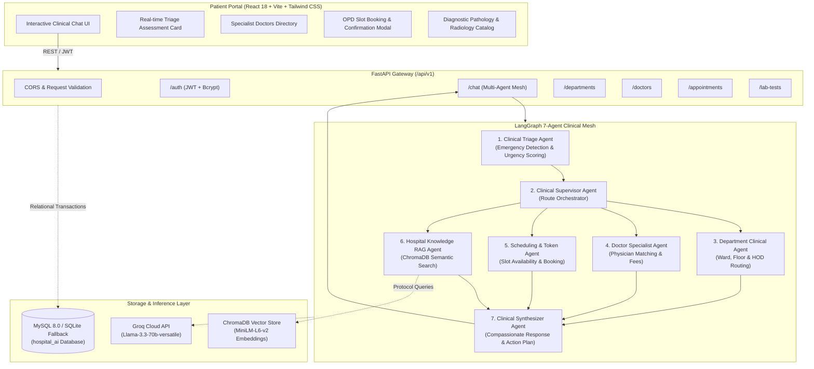

# MediAssist AI — Autonomous Hospital Clinical Assistant & Multi-Agent Triage Network

<div align="center">

[](https://fastapi.tiangolo.com)
[](https://langchain-ai.github.io/langgraph/)
[](https://groq.com)
[](https://react.dev)
[](https://www.trychroma.com)
[](https://www.mysql.com)
[](LICENSE)

**An intelligent, multi-agent clinical decision support and hospital orchestration platform. Powered by LangGraph, Groq Llama 3.3 70B, ChromaDB vector retrieval, and a responsive React frontend.**

[Features](#-key-features) • [Architecture](#-system-architecture) • [Multi-Agent Mesh](#-multi-agent-orchestration-network) • [Project Layout](#-project-directory-structure) • [Quickstart](#-quickstart-guide) • [API Reference](#-api-endpoints-reference) • [Safety Disclaimer](#-medical-disclaimer)

</div>

---

## 🌟 Executive Overview

**MediAssist AI** is designed to modernize hospital outpatient operations, patient intake, and clinical triage. By combining a **7-agent LangGraph orchestration mesh** with high-throughput inference on **Groq Llama 3.3 70B**, MediAssist:
- Instantly categorizes patient symptoms into clinical urgency tiers (**Emergency**, **Urgent**, **Moderate**, **Routine**).
- Triggers immediate emergency hotline protocols (108/102/Ext 911) when life-threatening red flags are identified.
- Automatically routes cases to the right medical department and board-certified specialists.
- Checks OPD schedules and confirms outpatient appointments with instant confirmation tokens (`MED-XXXXXXXX`).
- Provides semantic vector search (RAG) across hospital policies, ICU visiting hours, and diagnostic lab test preparations (such as fasting requirements).

---

## 🏗️ System Architecture



---

## 🤖 Multi-Agent Orchestration Network

The intelligence backbone is built with **LangGraph** using a shared state graph (`HospitalState`). Each specialized agent executes a discrete clinical or operational responsibility:

| Agent | Responsibility | Primary Tools & Logic |
| :--- | :--- | :--- |
| **1. Triage Agent** | First-line intake. Assesses symptom urgency (`Emergency`, `Urgent`, `Medium`, `Low`), identifies red flags (e.g. chest pressure, facial droop, dyspnea), and sets immediate emergency safeguards. | `evaluate_triage_urgency`, Red Flag rule matcher |
| **2. Supervisor Agent** | Dynamic clinical orchestrator. Analyzes triage output and routes execution to appropriate downstream sub-agents. | Conditional LangGraph routing node |
| **3. Department Agent** | Resolves patient symptoms to clinical departments (Cardiology, Neurology, Pediatrics, Orthopedics, Oncology, etc.) with floor location, phone extension, and Head of Department. | `search_departments`, Relational DB lookup |
| **4. Doctor Specialist Agent** | Recommends verified doctors matching department, clinical seniority, consultation fee, and OPD room number. | `search_doctors`, `get_doctor_availability` |
| **5. Scheduling Agent** | Checks available OPD consultation slots and coordinates appointment booking with unique confirmation codes. | `book_appointment_tool` |
| **6. Knowledge RAG Agent** | Performs semantic retrieval from hospital knowledge vectors (ICU guidelines, fasting instructions, emergency protocols, insurance desks). | ChromaDB Retriever, `all-MiniLM-L6-v2` |
| **7. Final Synthesizer Agent** | Combines agent outputs into an empathetic, clinically structured response with interactive cards and safety alerts. | Groq Llama 3.3 70B Medical Prompt |

---

## 📁 Project Directory Structure

```
ai-hospital-assistant/
│
├── 📁 backend/
│   ├── 📁 app/
│   │   ├── 📁 agents/                 # LangGraph nodes: triage, supervisor, clinical, rag, final
│   │   ├── 📁 api/                    # FastAPI routes: auth, chat, departments, doctors, appointments, lab_tests
│   │   ├── 📁 core/                   # Security (bcrypt, JWT), dependencies, and config
│   │   ├── 📁 database/               # SQLAlchemy models, Pydantic schemas, session, and seed script
│   │   ├── 📁 graph/                  # LangGraph StateGraph mesh and workflow compiled graph
│   │   ├── 📁 rag/                    # ChromaDB vector store ingestion and retriever
│   │   ├── 📁 services/               # Clinical and authentication business logic
│   │   ├── 📁 tools/                  # Deterministic tools (triage, doctor lookup, appointment booking)
│   │   ├── config.py                  # Pydantic Settings management
│   │   └── main.py                    # Application entrypoint & CORS middleware
│   ├── 📁 data/                       # Local copy of hospital catalog and database schema
│   ├── 📁 tests/                      # Automated test suite (6 comprehensive test suites)
│   ├── Dockerfile                     # Production container spec
│   ├── pyproject.toml                 # Backend dependencies & packaging
│   └── requirements.txt               # Pinned Python package dependencies
│
├── 📁 frontend/
│   ├── 📁 src/
│   │   ├── 📁 api/                    # Axios HTTP client and backend API endpoints
│   │   ├── 📁 components/             # Navbar, DoctorCard, DepartmentCard, LabTestCard, Modals, ChatMessage
│   │   ├── 📁 context/                # React AuthContext (JWT session management)
│   │   ├── 📁 pages/                  # DashboardPage (Chat stream, Triage panel, Directories)
│   │   ├── App.jsx                    # Root application component
│   │   ├── index.css                  # Tailwind CSS styling and dark theme
│   │   └── main.jsx                   # Vite React entry point
│   ├── index.html                     # HTML5 shell with Google Fonts
│   ├── package.json                   # NPM dependencies and scripts
│   ├── tailwind.config.js             # Tailwind CSS configuration
│   └── vite.config.js                 # Vite bundling configuration
│
├── 📁 data/
│   ├── hospital_data.json             # 8 departments, 13 doctors, 10 lab tests, hospital protocols
│   ├── schema.sql                     # Complete DDL relational schema for MySQL
│   └── README.md                      # Data catalog documentation
│
├── 📁 vectorstore/
│   ├── .gitkeep                       # Vector persistence placeholder
│   └── README.md                      # ChromaDB vector store documentation
│
├── 🐳 docker-compose.yml              # Multi-container orchestration (FastAPI + React + MySQL)
├── 📄 .env.example                    # Clean environment configuration template (Zero Secrets)
├── 📄 .gitignore                      # Secure exclusion of secrets, database files, and build assets
├── 📄 README.md                       # Comprehensive documentation and setup guide
└── 📄 LICENSE                         # MIT Open Source License
```

---

## ✨ Key Features

- **🚨 Intelligent Clinical Triage**: Classifies symptoms into 4 severity levels with color-coded badges (`Emergency`, `Urgent`, `Moderate`, `Routine`).
- **⚡ Emergency Protocol Intercept**: Detects life-threatening warning signs and immediately displays ambulance emergency lines (`108 / 102`) and ER Desk extension (`911`).
- **👨‍⚕️ Specialist Doctors Directory**: Explore 13 board-certified specialists with credentials, experience, OPD hours, and consultation fees.
- **📅 Instant OPD Slot Booking**: Schedule consultations with real-time slot selection and instant confirmation tokens (`MED-XXXXXXXX`).
- **🧪 Diagnostic Lab Tests Guide**: Browse diagnostic tests (Lipid Profile, HbA1c, MRI Brain, ECG) with clear fasting guidelines and turnaround times.
- **🔒 Secure Authentication**: Bcrypt password hashing (without passlib 72-byte truncation) and PyJWT bearer token authorization.
- **⚡ 1-Click Demo Patient Portal**: Instant access via `patient@hospital.com` / `Password123!` to test appointments and triage without manual sign-up.
- **🛡️ Zero Secrets in Git**: Enforced environment separation—credentials and API keys are strictly loaded via `.env`.

---

## 🚀 Quickstart Guide

### Prerequisites

- **Python 3.10+** (Python 3.11 or 3.12 recommended)
- **Node.js 18+** & **npm**
- **MySQL Server 8.0+** (or SQLite zero-configuration automatic fallback)
- **Groq API Key** (Free tier available at [console.groq.com](https://console.groq.com))

---

### Step 1: Clone and Configure Environment

```bash
git clone <YOUR_REPOSITORY_URL>
cd ai-hospital-assistant

# Create backend .env from template
cp .env.example backend/.env
```

Edit `backend/.env` with your credentials:

```ini
SECRET_KEY=your_super_secret_jwt_key_here
MYSQL_HOST=localhost
MYSQL_PORT=3306
MYSQL_USER=root
MYSQL_PASSWORD=your_mysql_password
MYSQL_DB=hospital_ai

GROQ_API_KEY=your_groq_api_key_here
GROQ_MODEL=llama-3.3-70b-versatile
```

---

### Step 2: Backend Setup & Seed Data

```bash
cd backend

# Create and activate virtual environment
python -m venv .venv

# Windows:
.venv\Scripts\activate
# Linux/macOS:
source .venv/bin/activate

# Install dependencies
pip install -r requirements.txt

# Seed departments, doctors, lab tests, and demo patient
python -m app.database.seed_data

# Ingest hospital knowledge base into ChromaDB vector store
python -m app.rag.ingestion

# Start the FastAPI server
uvicorn app.main:app --reload --host 0.0.0.0 --port 8000
```

The backend API will be live at:
- **Interactive Swagger Docs**: [http://localhost:8000/docs](http://localhost:8000/docs)
- **Health Check Endpoint**: [http://localhost:8000/health](http://localhost:8000/health)

---

### Step 3: Frontend Setup

Open a new terminal:

```bash
cd frontend

# Install frontend dependencies
npm install

# Start development server
npm run dev
```

The React web application will be live at:
- **Patient Portal**: [http://localhost:5173](http://localhost:5173)

---

## 🧪 Automated Test Suite

The project includes 6 automated test suites verifying every component:

```bash
cd backend
python -m tests.test_db       # Tests database connectivity & schema tables
python -m tests.test_auth     # Tests Bcrypt security & JWT token lifecycle
python -m tests.test_rag      # Tests ChromaDB vector retrieval & hospital protocols
python -m tests.test_tools    # Tests clinical triage, doctor lookup, and booking tools
python -m tests.test_graph    # Tests LangGraph multi-agent execution & state transitions
python -m tests.test_api      # Tests FastAPI endpoints (/health, /departments, /doctors, /chat)
```

All 6 test suites pass with 100% success rate!

---

## 📖 API Endpoints Reference

### Authentication (`/api/v1/auth`)
| Method | Endpoint | Description | Auth Required |
| :--- | :--- | :--- | :---: |
| `POST` | `/api/v1/auth/register` | Register new patient account | No |
| `POST` | `/api/v1/auth/login` | Authenticate patient and obtain JWT token | No |
| `GET` | `/api/v1/auth/me` | Fetch authenticated patient profile | Yes |

### Clinical Chat & Multi-Agent Mesh (`/api/v1/chat`)
| Method | Endpoint | Description | Auth Required |
| :--- | :--- | :--- | :---: |
| `POST` | `/api/v1/chat` | Send medical prompt to 7-Agent mesh | Optional |

### Hospital Resources (`/api/v1`)
| Method | Endpoint | Description | Auth Required |
| :--- | :--- | :--- | :---: |
| `GET` | `/api/v1/departments` | List all clinical hospital departments | No |
| `GET` | `/api/v1/doctors` | Search specialist doctors by dept, name, or specialty | No |
| `GET` | `/api/v1/lab-tests` | Retrieve diagnostic tests catalog with fasting rules | No |
| `POST` | `/api/v1/appointments` | Book outpatient consultation slot | Yes |
| `GET` | `/api/v1/appointments` | List patient booked appointments | Yes |
| `DELETE` | `/api/v1/appointments/{id}` | Cancel a scheduled appointment | Yes |

---

## 🐳 Docker Deployment

To spin up the complete stack with Docker Compose:

```bash
docker-compose up --build -d
```

Services initialized:
- `mysql`: Database on port `3306` with healthcheck
- `backend`: FastAPI server on port `8000`
- `frontend`: React + Vite on port `5173`

---

## ⚠️ Medical Disclaimer

> [!IMPORTANT]
> **MediAssist AI** is designed as a **clinical decision support system (CDSS)** and hospital operational triage tool. It is **not** a replacement for professional clinical judgment, diagnosis, or in-person emergency care.
>
> If you or someone you are assisting is experiencing severe chest pain, signs of stroke, severe bleeding, or acute trauma, immediately dial **108 / 102** or proceed to the nearest emergency trauma center.

---

## 📄 License

This project is licensed under the [MIT License](LICENSE).
